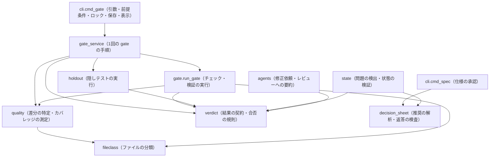

# アーキテクチャ改善の報告（PR #9・#10、0.6.5〜0.6.6）

「E-AQDL アーキテクチャ改善指示書」に沿って、#9（判断シート）と #10（差分の品質）を修正した記録です。

## 1. 調査対象

| 項目 | 内容 |
|---|---|
| ベースブランチ | `main`（f83e037、PR #8 まで） |
| 確認した PR | #9 `feat/decision-sheet`（main 向け）、#10 `feat/diff-quality`（main 向け。#9 の上に積み重ねた PR） |
| 修正前のコミット | #9: dfd3dd2、#10: 9bb768c |
| 修正後のコミット | #9: e66d6a4、#10: #9 の修正をマージで取り込み（force push を避けるため）、続けて修正（このファイルを含むコミット） |

| ブランチ | 変更・追加したファイル |
|---|---|
| #9 | `decision_sheet.py`（新規）、`state.py`、`cli.py`、`agents.py`、`skills/start/SKILL.md`、`README.md`、`tests/test_eaqdl_decision_sheet.py` |
| #10 | `verdict.py`・`gate_service.py`・`fileclass.py`（新規）、`gate.py`、`quality.py`、`holdout.py`、`state.py`、`agents.py`、`cli.py`、`README.md`、`tests/test_eaqdl_quality.py` |

## 2. 依存関係

AST で相対 import を数えました（関数内の遅延 import も含む）。

| | 変更前（#10 の元のコード） | 変更後 |
|---|---|---|
| import の循環 | `gate ↔ quality`、`agents → memory → state → agents`（強連結成分 agents・memory・state） | なし（パッケージ全体） |
| `quality` → | `gate`、`util` | `fileclass`、`util` |
| `gate` → | `project`、`quality`、`util` | `fileclass`、`project`、`quality`、`util`、`verdict` |
| `cli` → `quality` | あり（`cmd_gate` が差分カバレッジを直接呼ぶ） | なし（`gate_service` 経由） |
| 規則のモジュール | なし | `verdict`・`decision_sheet`・`fileclass` はパッケージ内に依存しない（葉） |

## 3. 修正内容

| 論点 | 責務の変更 | 利用者への影響 |
|---|---|---|
| P0-1 実行対象なしと合格の区別 | 結果の記録に `status`（passed / failed / error / skipped / not_applicable / pending / manual）・`reason`・`scope` を加えた。`pass` は後方互換で、**実行して合格したときだけ true**。gate を止めるかどうかは `verdict.check_ok()` が決める | 対象0件の Lint・型チェックは「対象なし」と記録され、gate は止めない（これまでどおり）。対象0件の単体テストなどのチェック、受け入れ条件に紐づく検証、対象なしのチェックに頼る検証は、**合格にならなくなった**。タイムアウト・コマンドなし（127）は「実行エラー」と表示する |
| P0-2 推奨の厳密な解析 | `decision_sheet.py` に推奨の解析と返答の検査を分けた（純粋関数）。推奨は「（推奨）」「(推奨)」の印だけ。印が2つ以上の質問は登録できない（既存のデータでは「推奨なし」）。判断シートの質問と推奨を仕様の指紋に入れた | 「非推奨の案」が推奨として承認で決まることがなくなった。提示の後に推奨が変わったら、提示し直すまで承認できない。「Q1 は推奨で。承認 SPEC-…」は承認になる（実験14 で6回中3回、余分な往復を生んでいた）。推奨以外の選択肢・「ではなく」「変えたい」などを含む返答は、これまでどおり承認にしない |
| P0-3 差分カバレッジの証拠の鮮度 | gate の前に前回のレポートを消す（`quality.invalidate_report`）。あれば、この gate のチェックが作ったもの。レポートの sha1 と gate の実行 ID を `evidence` に残す。消せない・ない・壊れている・未計測のファイルがある、はすべて不合格 | 「開始時刻の1秒前まで許す」時刻の比較をやめた。gate の直前に置かれたレポートは使われない |
| P1-1 循環依存 | `TEST_FILE`・`CODE_EXT` を `fileclass.py` に移した（`gate.py` にあった定義をそのまま。`gate.TEST_FILE` の名前も残す） | なし |
| 以前からの循環（追加の対応） | `state` が使っていた2つの関数を、規則の持ち主に移した。Role Profile の選び方（`agents.role_selection`）は `roles.select_for` に、共通 Memory の承認の対象 ID（`memory.scope_target`）は `approval.memscope_target` に移した。元の名前は薄い入口として残す | なし（`role_selection`・`scope_target` はこれまでどおり呼べる） |
| P1-2 結果の契約 | `verdict.py` に記録を作る関数（`from_run`・`no_targets`・`via_checks`・`diff_coverage` など）と判定（`status_of`・`check_ok`・`failures`・`overall`）を置いた。旧版の記録（status なし）は `status_of` が読み替える | なし（旧版の state.json はそのまま読める） |
| P1-3 cli・state の責務 | `cmd_gate` の実行手順を `gate_service.run` に移した。`cmd_gate` は前提条件・ロック・保存・表示だけ。担当への文章（`quality_summary_lines`）は `quality` から `agents` に移した | なし（表示の文言はこれまでどおり） |
| AC-06 共通の結果からの引き継ぎ | `state` の問題の表示、`agents` の修正依頼、状態の検証は、すべて `verdict.failures()`・`check_ok()` を使う。品質の検査は `verdict.QUALITY_KEYS` で共通に扱う | なし |
| 状態の改ざんの検出 | `status` と `pass` が食い違う記録は合格として扱わず、状態の検証でも報告する | 全体のテストで、gate の合格の偽装の検出（`test_forged_gate_pass_is_detected`）が働かなくなっていたのを見つけて直した |
| 独立レビュー | レビュー担当への「Lint の個々の警告は機械に任せる」に、「チェック・検証の対象や条件を承認なしに狭めた変更は指摘する」を加えた | 実験14 で見えた、正当な指摘まで抑えるおそれへの対処 |

**AC-09（変更が及ぶモジュール）**: 品質の検査（例: SAST）を1つ足すとき、変更前は `gate`・`quality`（実行）、`cli`（実行順と合否の集計）、`state`（問題の表示）、`agents`（修正依頼）の5か所に分岐が必要でした。変更後は次の3か所です。修正依頼の手がかりの文を付けたい場合だけ、`agents._quality_fix_hint` に1つ足します。
- 実行側（新しいモジュールか `quality`）
- `gate_service`（実行の順番）
- `verdict`（記録の作り方と `QUALITY_KEYS`）

## 4. 再現結果

| 懸念 | 結果 | 根拠 |
|---|---|---|
| P0-1 必須の検証が対象なしで合格になる | **再現した** | 修正前のコードで、`{changed:.rs}` の単体テストのチェックが対象0件のまま `pass: true`・gate 合格になった。修正後は not_applicable・gate 不合格 |
| P0-2 「非推奨」を推奨にする | **再現した** | `"推奨" in option` のため。「非推奨の案|100文字」で提示でき、承認で「非推奨の案」に決まった |
| P0-2 本文中の「推奨」を推奨にする | **再現した** | 「推奨値を使う|100文字」で同じ |
| P0-2 複数の推奨 | **再現した** | 登録でき、最初の1つが使われていた |
| P0-2 提示の後に推奨が変わっても承認できる | **再現した**（指示書にない追加の懸念） | 仕様の指紋に質問が入っていなかった。提示の後に推奨を入れ替えても、古い SPEC の承認で新しい推奨に決まった |
| P0-2 推奨どおりの返答が承認にならない | **再現した**（実験14 の結果） | 「Q1 は推奨案でお願いします。承認 SPEC-…」が、質問 ID への言及だけで拒否された |
| P0-3 直前に作られたレポートを使う | **再現した** | 修正前のコードで、gate の直前に置いたレポートがそのまま合格の証拠になった |
| P1-1 gate ↔ quality の循環 | **再現した** | 関数内の遅延 import で相互に参照していた |

それぞれの再現テストは、修正前のコードでは失敗（または、status の項目がないためのエラー）になることを確かめた。P0-1・P0-3 は、旧コードの挙動を直接実行しても確かめた。

## 5. テスト結果

| 実行 | 結果 |
|---|---|
| #9 の修正後（e66d6a4）: `python3 -m unittest discover -s tests -q`（Linux、Python 3.13） | 208 件合格 |
| #9 の修正後: GitHub Actions（Ubuntu・Windows・macOS × Python 3.8・3.12 ほか、10 ジョブ） | 10 件すべて合格 |
| #10 の修正後: `python3 -m unittest discover -s tests -q`（Linux、Python 3.13） | 235 件合格（修正の途中の1回で、gate の合格の偽装の検出のテストが1件失敗。原因を直して再実行） |
| #10 の修正後: GitHub Actions | この PR のチェックを参照（報告を書いた時点では未実行。結果は PR の本文に書く） |

追加したテストは次のとおり。
- `test_eaqdl_decision_sheet.py`（11 件）
  - 推奨の解析（全角・半角の印、「非推奨」、本文の「推奨」、複数の推奨、印だけの選択肢）
  - 提示の後の推奨の変更 → 提示し直し → 承認
  - 推奨どおりの返答（範囲「Q1〜Q4」を含む）
  - 推奨以外・否定・「食い違いはありません」を含む返答
  - 承認の前後で指紋が変わらないこと
- `test_eaqdl_quality.py`（15 件）
  - 対象0件の任意の Lint・必須のチェック・必須の検証・対象なしのチェックに頼る検証
  - 必須のテストの正常実行、対象ありの Lint の不合格、タイムアウト・コマンドなし
  - 直前のレポート・壊れたレポート・証拠の sha1 と実行 ID
  - 合否の規則の単体テスト、旧版の記録の読み替え、status と pass の食い違い
  - パッケージ全体に import の循環がないこと（修正前のコードでは state → memory → state で失敗することを確認）・規則のモジュールが葉であること・各モジュールの単独 import

制約:
- Windows の CRLF は、#10 の既存のテスト（`core.autocrlf=true` の作業ツリー）と CI の Windows ジョブで確かめる。
- ローカルは Linux だけで実行した。

## 6. 残る課題

**必須ではないが、早めに対応したほうがよいもの**
- （解消済み）以前からあった `agents`・`memory`・`state` の import の循環は、追加の対応でなくした（上の表）。パッケージ全体に循環がないことをテストで確かめている。
- 判断シートの返答の検査は、言葉による規則（「ではなく」「変えたい」など）で、安全側（承認しない側）に倒している。
  - 想定外の言い方では承認されず、往復が1回増えることがある。誤って承認する方向の誤りは、推奨以外の選択肢の文字列と否定の言葉で防いでいる。
- 「仕様書の本文が推奨を前提に書かれているか」は機械では確かめていない。
  - 保証しているのは、人に見せた推奨と承認で決まる推奨が一致することまで（仕様の指紋）。本文との整合は、要求分析担当の指示と人の確認による。

**将来の改善の候補**
- `cmd_spec`（提示・承認）も `cmd_gate` と同じく、手順を別の関数に分ける。
- 差分カバレッジ以外の品質の検査（SAST など）は、必要になったときに `QUALITY_KEYS` と実行側に足す。プラグインの登録の仕組みは作っていない。

**不要と判断したリファクタリング**
- ディレクトリの移動、`cli.py`・`state.py` の全面的な分割、クラスやインターフェースの導入、イベントの仕組み。
  - 指示書の「大規模な構造刷新を目的としない」に従った。今回の変更で波及を減らせる箇所（gate の手順・合否の規則・判断シートの規則）だけを分けた。

## 7. PR への反映方針

- #9（`feat/decision-sheet`）に判断シートの修正（P0-2 と、推奨どおりの返答の扱い）を載せた。
- #10（`feat/diff-quality`）には、修正後の #9 をマージで取り込み（履歴を書き換える force push をしないため）、P0-1・P0-3・P1-1〜P1-3 を載せた。全体のテストは、この内容と同じツリーで実行した。#10 は #9 を含むので、**#9 を先にマージしてください**。マージ後は、#10 の差分は #10 の変更だけになります。
- どちらも、マージはしていません（ユーザーの判断を待ちます）。
